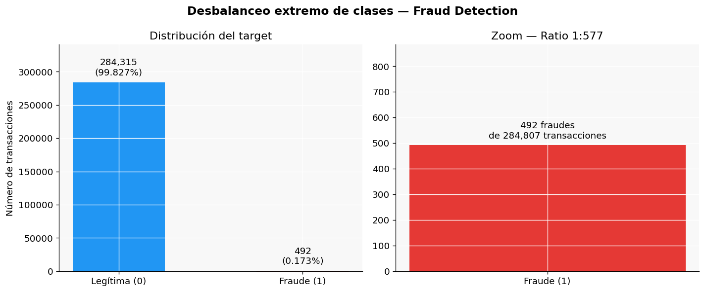
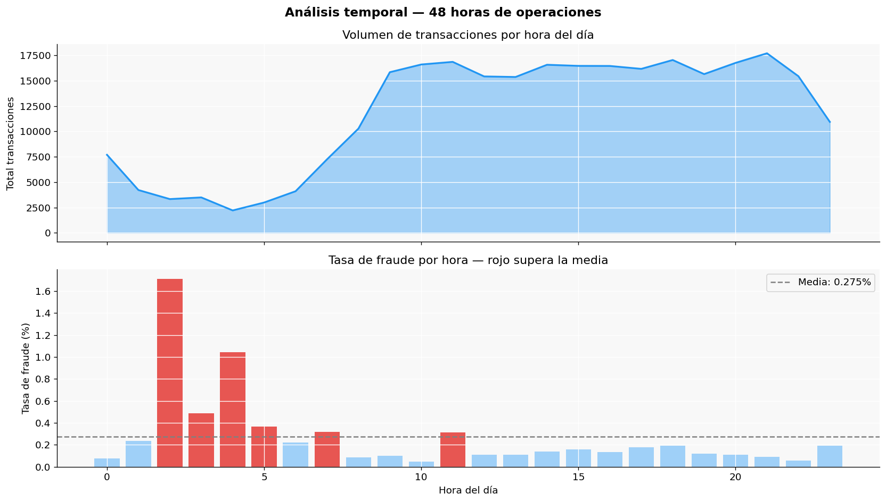
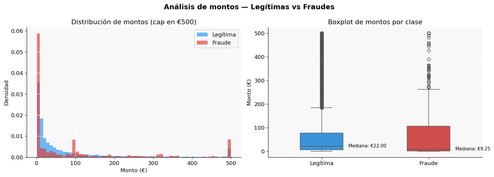
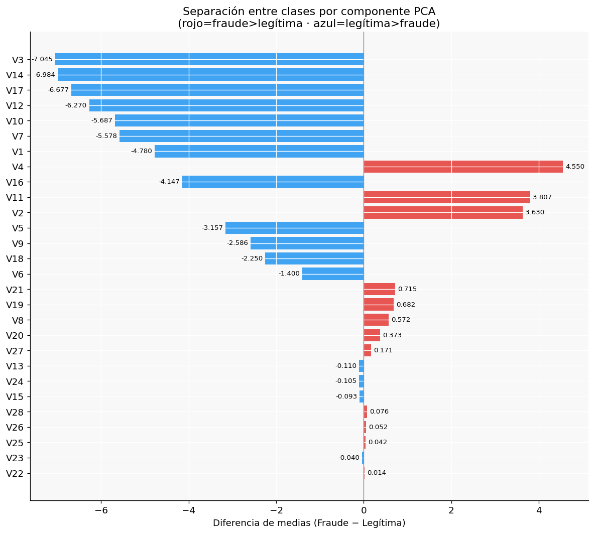
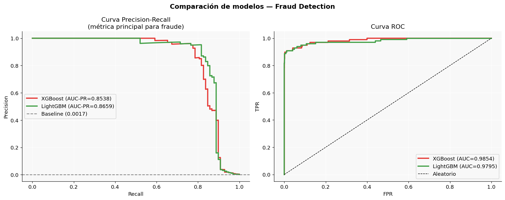
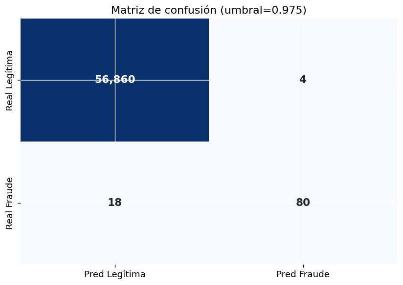
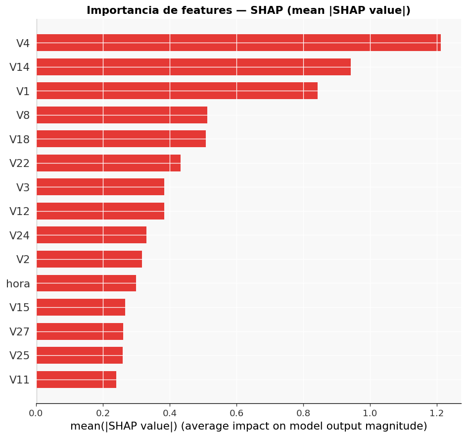

# Fraud Detection

Sistema de detección de fraude en transacciones de tarjeta de 
crédito construido con datos reales de Kaggle siguiendo 
estándares MLOps de producción.

## Estructura del proyecto

```
fraud-detection/
├── data/
│   ├── raw/                  <- Dataset original de Kaggle (no incluido)
│   └── processed/            <- Datos procesados (generados por los notebooks)
├── sql/
│   └── 01_fraud_analysis.sql <- Queries de análisis con DuckDB
├── notebooks/
│   ├── 01_DA_EDA.ipynb       <- Parte 1: Análisis exploratorio
│   └── 02_DS_FraudModel.ipynb <- Parte 2: Modelo LightGBM + SHAP
├── dashboard/                <- El .pbix no se incluye (pesa 126 MB)
├── models/                   <- El modelo .pkl se genera al ejecutar el notebook 02
├── reports/
│   └── figures/              <- Gráficos generados
└── README.md
```

## Dataset

**Credit Card Fraud Detection** · [Kaggle](https://www.kaggle.com/datasets/mlg-ulb/creditcardfraud)

| Campo | Valor |
|---|---|
| Registros | 284,807 transacciones |
| Periodo | Septiembre 2013 (48 horas) |
| Clientes | Europeos |
| Target | Fraude (Class: 0/1) |
| Tasa de fraude | 0.1727% |
| Ratio desbalanceo | 1:577 |

### Variables

| Variable | Descripción |
|---|---|
| `Time` | Segundos desde la primera transacción |
| `V1` – `V28` | Componentes PCA (confidenciales) |
| `Amount` | Importe de la transacción en euros |
| `Class` | Target — 0=legítima, 1=fraude |

## Instalación

```bash
git clone https://github.com/eramosdata-dev/fraud-detection.git
cd fraud-detection
python -m venv .venv
.venv\Scripts\activate
pip install -r requirements.txt
```

> **Nota:** Descarga `creditcard.csv` de Kaggle y colócalo en `data/raw/`.

## Resultados

### Análisis exploratorio (Parte 1)

| Hallazgo | Valor |
|---|---|
| Tasa de fraude global | 0.1727% |
| Ratio desbalanceo | 1:577 |
| Hora con mayor tasa de fraude | 2h (1.71%) |
| Monto mediano legítima | €22.00 |
| Monto mediano fraude | €9.25 |
| Componentes más discriminantes | V4, V14, V3, V17 |

### Modelo final — LightGBM

| Métrica | Valor |
|---|---|
| AUC-PR | 0.8659 |
| AUC-ROC | 0.9795 |
| Precision | 0.9524 |
| Recall | 0.8163 |
| F1-Score | 0.8791 |

### Impacto económico (test set)

| Concepto | Valor |
|---|---|
| Fraude detectado | €7,901.31 |
| Fraude no detectado | €2,746.62 |
| % valor protegido | 74.2% |

## Visualizaciones

### Desbalanceo de clases


### Análisis temporal


### Análisis de montos


### Separación por componentes PCA


### Comparación de modelos


### Matriz de confusión


### Importancia SHAP


## Dashboard Power BI

El archivo `.pbix` no se incluye por tamaño (126 MB). Versión exportada del dashboard:

[Ver dashboard en PDF](reports/fraud_dashboard.pdf)

## Stack tecnológico

| Herramienta | Uso |
|---|---|
| Python 3.10 | Lenguaje principal |
| Pandas / NumPy | Manipulación de datos |
| Matplotlib / Seaborn | Visualización |
| DuckDB | SQL analítico en local |
| Scikit-learn | Preprocesamiento y métricas |
| LightGBM | Modelo de detección de fraude |
| XGBoost | Modelo comparativo |
| imbalanced-learn | SMOTE para desbalanceo |
| SHAP | Explicabilidad del modelo |
| Power BI | Dashboard ejecutivo |
| Joblib | Serialización del modelo |

## Stack del proyecto

- **Parte 1 — Data Analyst:** Python · DuckDB · Power BI
- **Parte 2 — Data Scientist:** Python · LightGBM · SMOTE · SHAP